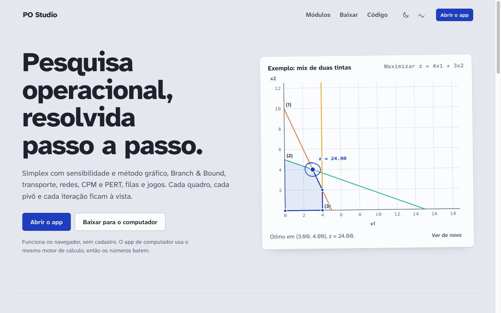
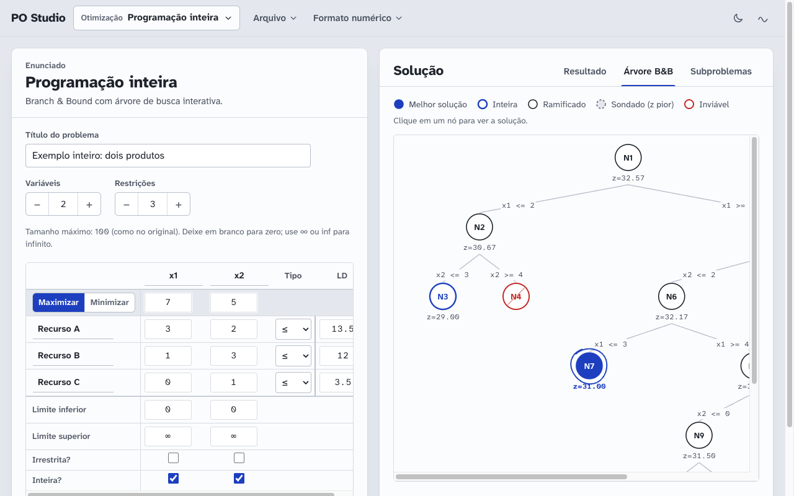
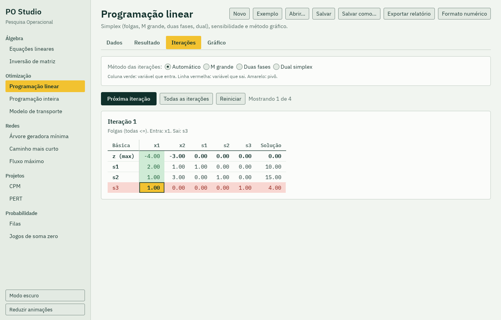

# PO Studio

[](https://github.com/16Jorgecamargo/po-studio/actions/workflows/ci.yml)
[](https://github.com/16Jorgecamargo/po-studio/releases)
[](#license)
[](https://www.rust-lang.org/)
[](web/)

**Operations research, step by step, in the browser or on the desktop.** PO Studio solves linear programming problems with the simplex method and shows every tableau, every pivot and every iteration. It also covers the rest of a typical operations research course: integer programming, the transportation problem, network models, CPM and PERT, queueing theory and game theory.

It is built for students and teachers who want to check an exercise and understand how the answer was reached, not just see the final number. Think of it as a step-by-step simplex calculator that needs no account and sends nothing to a server.

The interface is in Brazilian Portuguese ("PO" stands for *pesquisa operacional*, operations research). Translations are welcome.

[Leia em português](README.md)



## What it solves

| Area | Module | Methods |
|---|---|---|
| Algebra | Linear equations | Systems of simultaneous equations and determinant |
| Algebra | Matrix inversion | Inverse and determinant of a square matrix |
| Optimization | Linear programming | All-slack simplex, Big M, two-phase and dual simplex, sensitivity analysis, graphical method |
| Optimization | Integer programming | Branch & Bound with an interactive search tree |
| Optimization | Transportation | Northwest corner, least cost and Vogel's approximation, with iteration tableaus |
| Networks | Minimum spanning tree | Shortest total length connecting every node |
| Networks | Shortest path | Dijkstra and Floyd |
| Networks | Maximum flow | Largest flow from source to sink |
| Projects | CPM | Critical path, floats and Gantt chart |
| Projects | PERT | Mean, variance and probability of meeting a deadline |
| Probability | Queues | (M/M/c):(GD/N/K) models, pure birth and pure death |
| Probability | Zero-sum games | Optimal strategies via LP and graphical solution |

Every module offers step-by-step iterations, charts, open and save (`.json` and the original program's `.txt` format), report export, adjustable number format and light or dark theme.

| Branch & Bound on the website | Simplex tableau in the desktop app |
|---|---|
|  |  |

## Two front ends, one engine

- **Desktop app** for Windows, macOS and Linux, written in Rust with [egui](https://github.com/emilk/egui). Works offline.
- **Website** in React that runs the same Rust core compiled to WebAssembly. All computation happens in your browser.

Both front ends share one solver crate (`crates/po-core`), so the numbers always match.

## Download

Installers are published under [Releases](https://github.com/16Jorgecamargo/po-studio/releases): `.dmg` for macOS (Apple Silicon and Intel), setup and portable `.exe` for Windows, `.deb` and `.tar.gz` for Linux.

## Build from source

```
cargo run --release            # desktop app
cargo test -p po-core          # solver tests
cd web && npm install && npm run dev   # website
```

After changing anything in `crates/`, rebuild the WebAssembly bundle with `scripts/build-wasm.sh` (requires [wasm-pack](https://rustwasm.github.io/wasm-pack/)) and commit the result. CI checks that `web/src/wasm` matches `crates/`.

## Contributing

Bug reports, fixes, new examples and translations are welcome. See [CONTRIBUTING.md](CONTRIBUTING.md) and the [code of conduct](CODE_OF_CONDUCT.md). Issues and pull requests in English are fine.

## Citing

If you use PO Studio in a class, handout or paper, GitHub's "Cite this repository" button builds the citation from [CITATION.cff](CITATION.cff).

## License

Licensed under either of

- [MIT license](LICENSE-MIT)
- [Apache License, Version 2.0](LICENSE-APACHE)

at your option. The IBM Plex fonts in `assets/fonts` are under the [SIL Open Font License 1.1](assets/fonts/OFL.txt).

Unless you explicitly state otherwise, any contribution intentionally submitted for inclusion in this project shall be dual licensed as above, without any additional terms or conditions.
