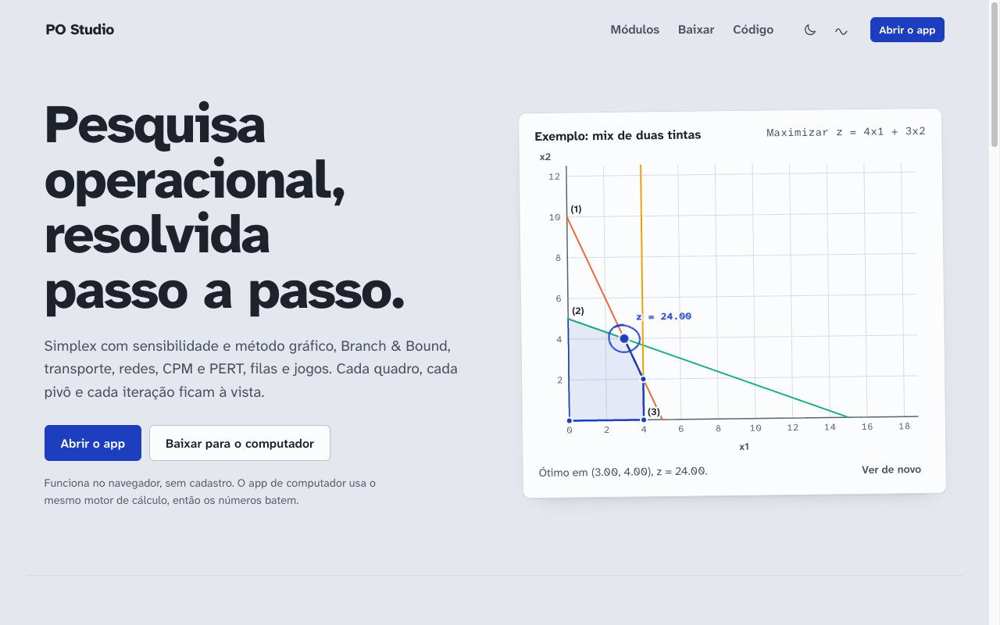
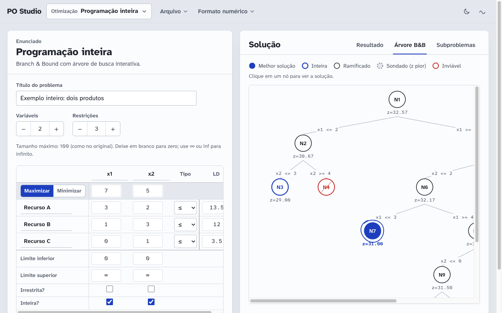
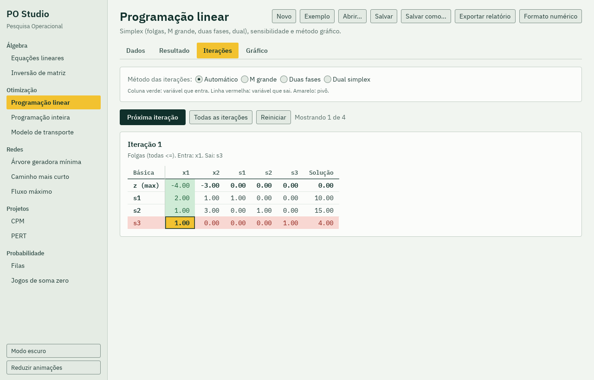
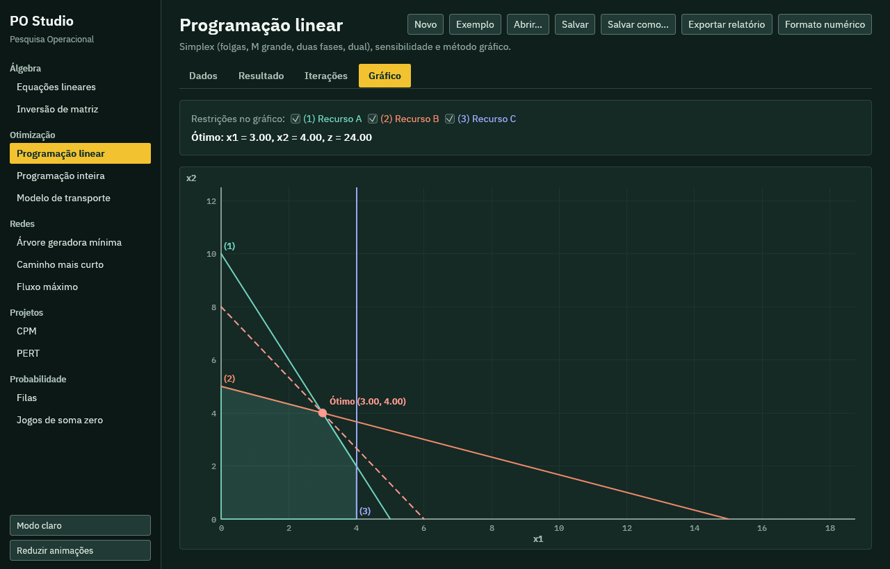

# PO Studio

[](https://github.com/16Jorgecamargo/po-studio/actions/workflows/ci.yml)
[](https://github.com/16Jorgecamargo/po-studio/releases)
[](#licença)
[](https://www.rust-lang.org/)
[](web/)

**Pesquisa operacional passo a passo, no navegador ou no computador.** Resolve programação linear pelo método simplex mostrando cada quadro, cada pivô e cada iteração, e cobre os outros temas de um curso de PO: programação inteira, transporte, redes, CPM e PERT, filas e teoria dos jogos.

Feito para estudantes e professores de pesquisa operacional (engenharia de produção, administração, economia, computação) que querem conferir um exercício e entender o caminho até a resposta, não só o número final. Funciona como uma calculadora do método simplex passo a passo, sem cadastro e sem enviar nada para servidor.

[Read in English](README.en.md)



## O que resolve

| Área | Módulo | Métodos |
|---|---|---|
| Álgebra | Equações lineares | Sistemas de equações simultâneas e determinante |
| Álgebra | Inversão de matriz | Inversa e determinante de matriz quadrada |
| Otimização | Programação linear | Simplex com folgas, M grande, duas fases e dual simplex, análise de sensibilidade, método gráfico |
| Otimização | Programação inteira | Branch & Bound com árvore de busca interativa |
| Otimização | Modelo de transporte | Canto noroeste, custo mínimo e Vogel, com quadros de iteração |
| Redes | Árvore geradora mínima | Menor comprimento total ligando todos os nós |
| Redes | Caminho mais curto | Dijkstra e Floyd |
| Redes | Fluxo máximo | Maior fluxo da origem ao destino |
| Projetos | CPM | Caminho crítico, folgas e gráfico de Gantt |
| Projetos | PERT | Média, variância e probabilidade de cumprir o prazo |
| Probabilidade | Filas | Modelos (M/M/c):(GD/N/K), nascimento e morte puros |
| Probabilidade | Jogos de soma zero | Estratégias ótimas por PL e solução gráfica |

Em todos os módulos: iterações passo a passo, gráficos, abrir e salvar problemas (`.json` e o `.txt` do programa original), exportar relatório, formato numérico ajustável e tema claro ou escuro.

| Branch & Bound no site | Quadro do simplex no app de computador |
|---|---|
|  |  |

## Duas formas, o mesmo motor

- **App de computador** para Windows, macOS e Linux, feito em Rust com [egui](https://github.com/emilk/egui). Funciona sem internet.
- **Site** em React que roda o mesmo núcleo Rust compilado para WebAssembly. O cálculo acontece no seu navegador.

As interfaces são diferentes de propósito, mas o núcleo de cálculo (`crates/po-core`) é um só, então os números batem nas duas.



## Baixar

Os instaladores ficam em [Releases](https://github.com/16Jorgecamargo/po-studio/releases).

| Sistema | Arquivo | Como instalar |
|---|---|---|
| macOS (Apple Silicon e Intel) | `PO-Studio-<versão>-macos.dmg` | Abrir o .dmg e arrastar o PO Studio para Aplicativos. Na primeira vez, clicar com o botão direito no app e escolher Abrir. |
| Windows | `PO-Studio-<versão>-windows-setup.exe` | Executar e seguir o assistente. Também há uma versão portátil `...-windows-portable.exe`. |
| Linux (Debian/Ubuntu) | `po-studio_<versão>_amd64.deb` | Dar dois cliques ou rodar `sudo apt install ./po-studio_<versão>_amd64.deb`. |
| Linux (qualquer distribuição) | `PO-Studio-<versão>-linux-x86_64.tar.gz` | Extrair e rodar `./install.sh`. |

## Estrutura

```
crates/po-core   núcleo de cálculo em Rust, sem interface (solvers, relatórios, formato do programa original)
crates/po-wasm   ligação do núcleo com o navegador (wasm-bindgen)
src/             app de computador (egui)
web/             site (React + TypeScript + Vite)
web/src/wasm     núcleo já compilado para WebAssembly, versionado para a Vercel não precisar de Rust
packaging/       scripts dos instaladores
```

## Desenvolvimento

App de computador:

```
cargo run --release
```

Testes do núcleo:

```
cargo test -p po-core
```

Site:

```
cd web
npm install
npm run dev
```

Depois de mudar qualquer coisa em `crates/`, gere o WebAssembly de novo e faça commit do resultado (precisa de [wasm-pack](https://rustwasm.github.io/wasm-pack/)):

```
scripts/build-wasm.sh
```

A integração contínua confere se `web/src/wasm` está em dia com `crates/` (`scripts/check-wasm.sh`).

## Publicar o site na Vercel

1. Importe este repositório na Vercel.
2. Deixe a pasta raiz como está. O `vercel.json` já define instalação, build (`web/dist`) e o redirecionamento das rotas do app.

## Gerar os instaladores

Crie uma tag `v<versão>` (por exemplo `v1.0.1`) e envie para o GitHub. O fluxo `installers` gera os instaladores dos três sistemas e anexa a uma release. Detalhes em [packaging/README.md](packaging/README.md).

## Contribuir

Correções, novos exemplos, traduções e relatos de erro são bem-vindos. Veja [CONTRIBUTING.md](CONTRIBUTING.md) e o [código de conduta](CODE_OF_CONDUCT.md). Achou um resultado diferente do livro? Abra uma [issue](https://github.com/16Jorgecamargo/po-studio/issues/new/choose) com o problema e a resposta esperada.

## Citar

Se usar o PO Studio em aula, apostila ou trabalho acadêmico, o GitHub gera a citação pelo botão "Cite this repository", a partir de [CITATION.cff](CITATION.cff).

## Licença

O código é distribuído sob duas licenças, à sua escolha:

- [MIT](LICENSE-MIT)
- [Apache 2.0](LICENSE-APACHE)

As fontes IBM Plex em `assets/fonts` usam a [SIL Open Font License 1.1](assets/fonts/OFL.txt).

Salvo aviso em contrário, qualquer contribuição enviada a este repositório é licenciada nos mesmos termos (MIT ou Apache 2.0), sem condições adicionais.
